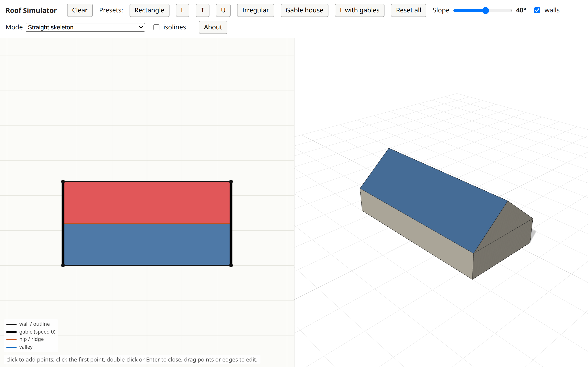
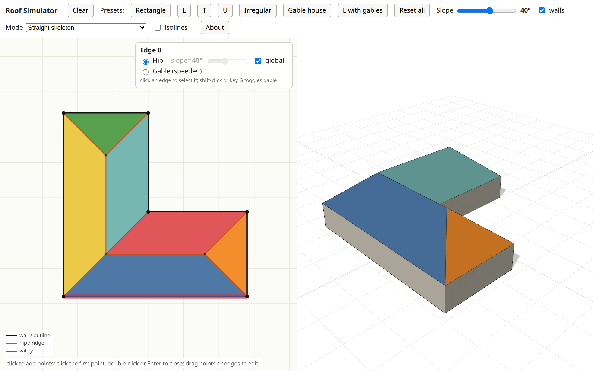
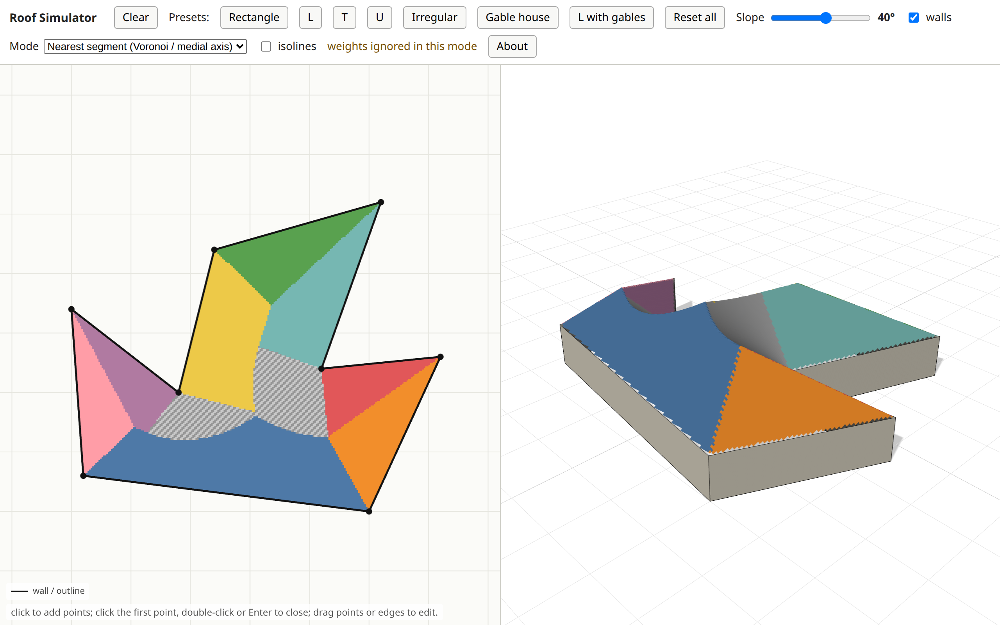
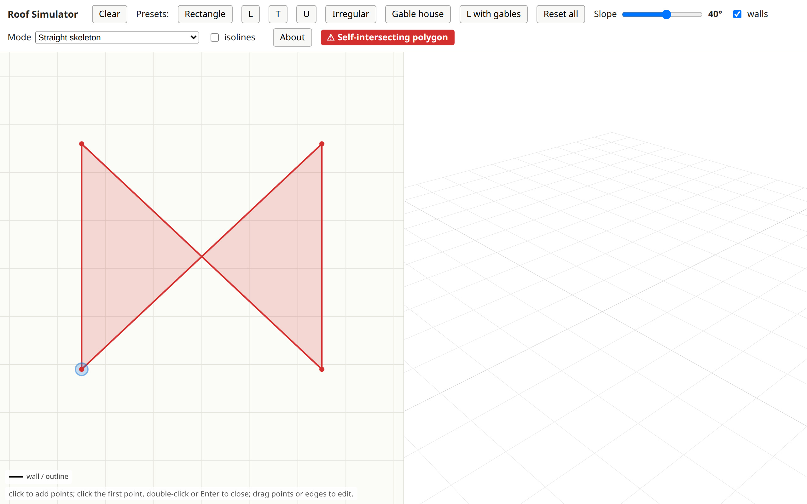

# Roof Simulator
Straight skeleton of a drawn polygon (2D plan + three.js roof). Vite + TypeScript + Vitest + Open Props.


*Main view: the 2D plan (faces coloured per roof plane) and the 3D roof.*


*Isolines every 0.25 m (thin grey, no labels) with the skeleton in red; the 3D view shows the lit roof with black plane outlines and a cast shadow.*


*Gable edges (per-edge profiles).*


*Selected edge: hip (slope follows the global slope or has its own) or gable.*


*Nearest-segment (Voronoi / medial axis) mode.*


*Invalid geometry is flagged in red and no roof is built.*

Screenshots are regenerated with `npm run screenshots` (headless Chromium via Playwright, output in `docs/screenshots/`).


```
npm install
npm run dev        # dev server; ?preset=L&mode=nearest picks preset and mode
npm test           # vitest: skeleton (area sum, simple faces, node height = distance to face planes, 300 random polygons) and nearest-segment checks
npm run typecheck
npm run build      # tsc --noEmit && vite build -> dist/
npm run preview
```

Core algorithm in `src/geometry/skeleton.ts`.

## Deployment
Pushes to `main` build and deploy `dist/` to GitHub Pages via `.github/workflows/deploy.yml`.
In the repo settings, set **Pages > Source** to **GitHub Actions**. The site is served under `/roof-simulator/` (`base` in `vite.config.ts`).
