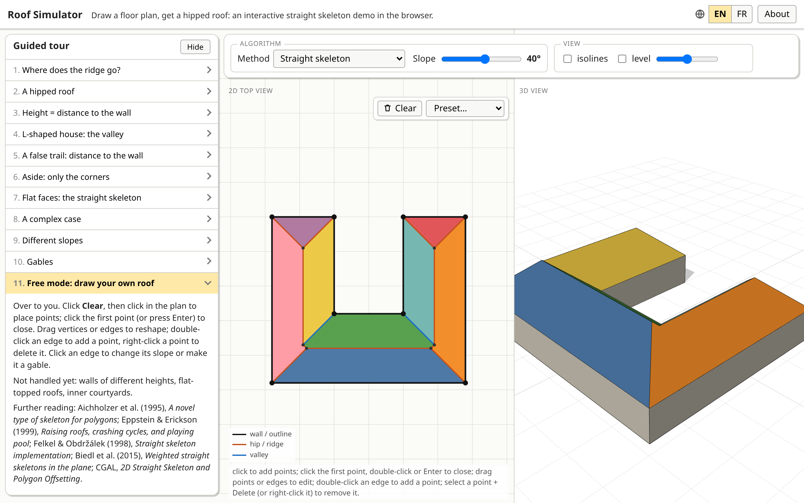
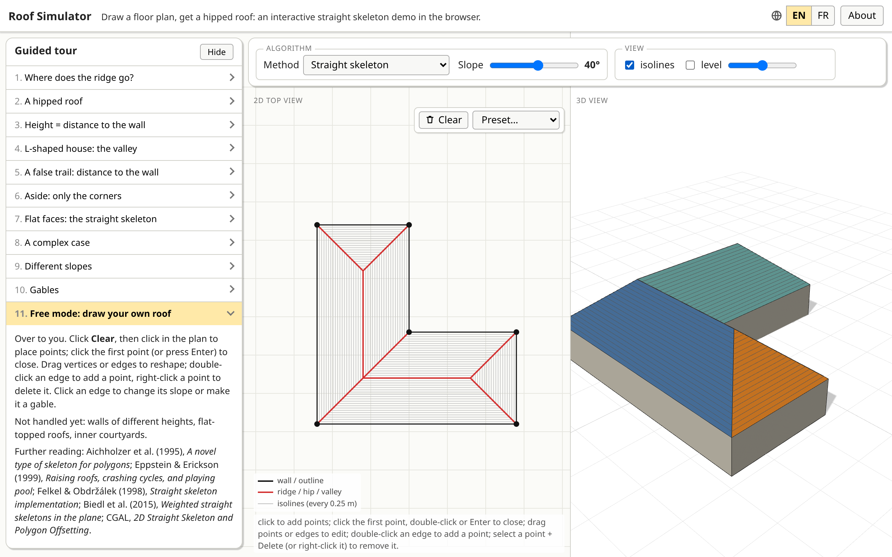

# Roof Simulator
Straight skeleton of a drawn polygon (2D plan + three.js roof). Vite + TypeScript + Vitest + Open Props.


*Main view: the 2D plan (faces coloured per roof plane) and the 3D roof.*


*Isolines every 0.25 m (thin grey, no labels) with the skeleton in red; the 3D view shows the lit roof with black plane outlines and a cast shadow.*

## Guided tour
A left panel (below the views on screens < 800px; "Tour" button to hide it, PageUp / PageDown to step) walks through 11 steps in French: simple roof, level line, valley, arbitrary angles, gables, gables on an L, per-edge slopes, Voronoi of points, Voronoi of segments, straight skeleton vs medial axis, free mode.
Steps are plain data in `src/tour/steps.ts` (footprint as a preset name or an explicit `pts` polyline, gables, per-edge slopes, mode, global slope, isolines, walls, 3D camera, level line, highlights; see the `Step` interface) and are applied by `src/ui/tour.ts`. Any view setting a step leaves out goes back to its default.
`?step=<id>` opens a step; `?preset=` / `?mode=` still work and open the free mode. Toolbar additions used by the tour: the "level" slider (level line in 2D, translucent cut plane in 3D) and the "Nearest vertex" mode.

Screenshots are regenerated with `npm run screenshots` (headless Chromium via Playwright, output in `docs/screenshots/`).


```
npm install
npm run dev        # dev server; ?step=noue opens a tour step, ?preset=L&mode=nearest a preset and mode
npm test           # vitest: skeleton (area sum, simple faces, node height = distance to face planes, 300 random polygons) and nearest-segment checks
npm run typecheck
npm run build      # tsc --noEmit && vite build -> dist/
npm run preview
```

Core algorithm in `src/geometry/skeleton.ts`.

## Deployment
Pushes to `main` build and deploy `dist/` to GitHub Pages via `.github/workflows/deploy.yml`.
In the repo settings, set **Pages > Source** to **GitHub Actions**. The site is served under `/roof-simulator/` (`base` in `vite.config.ts`).
